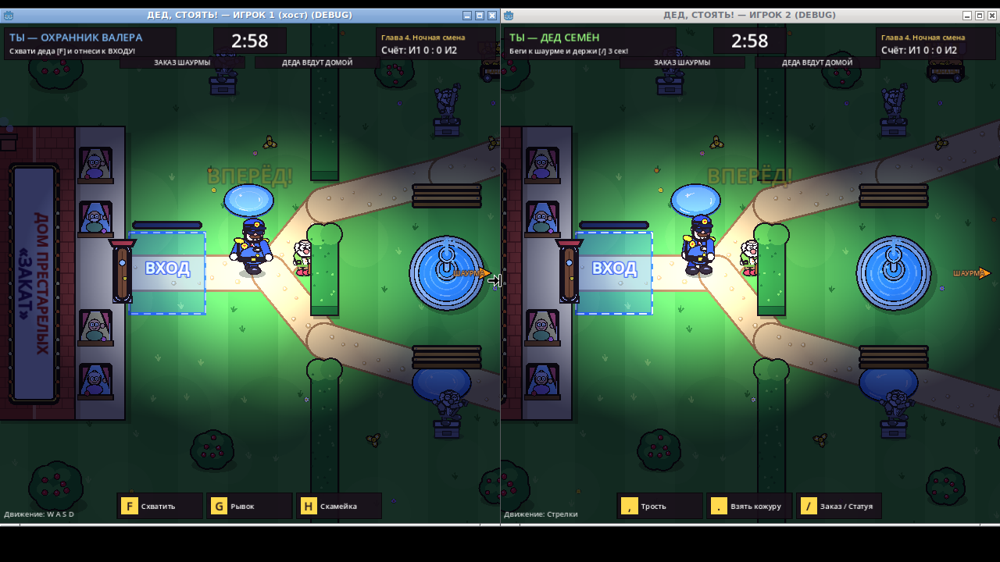
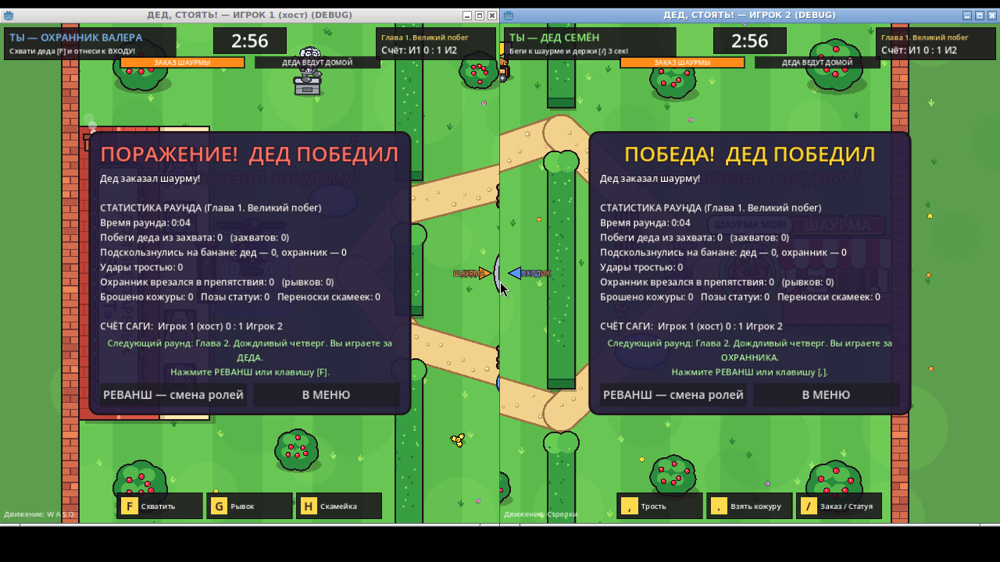

# ДЕД, СТОЯТЬ! — Grandpa, Get Back Here!

A two-player asymmetric comedy brawl for **Godot 4.4** (GDScript, 2D). Grandpa Semyon has escaped from the
«Закат» retirement home and wants a shawarma. Guard Valera has to drag him back before his shift ends.
All in-game text is in Russian.

* Real networked multiplayer over **localhost (127.0.0.1)**, using ENet in two separate game windows. The host is authoritative.
* There is no internet, account, VPN or external server, and no paid or external assets. All art is drawn procedurally and all sounds are synthesized at startup.
* A six-chapter story ("сага") with a different twist in each chapter (rain, a banana delivery, night, a bench uprising, a grand finale), followed by endless bonus rounds. The overall score is tracked per player and roles swap every round.

## Requirements

* **Godot 4.4.1** (standard, non-.NET build). This is the version it was built and tested with. Other 4.4.x releases should work.
* Any OS that Godot supports. Everything runs on one computer with one keyboard.

## Run two instances

### Option A: from the Godot editor

1. Open Godot 4.4, click **Import**, and select `grandpa_game/project.godot`.
2. Open **Debug → Customize Run Instances…**, tick **Enable Multiple Instances**, and set the count to **2**.
3. Press **F5** (Run Project). Two game windows open.
4. In the first window click **«СОЗДАТЬ ИГРУ (хост)»**. In the second window click **«ПОДКЛЮЧИТЬСЯ к 127.0.0.1»**.

(Optional: in the same dialog you can give instance 1 the launch arguments `-- --host` and instance 2 the
arguments `-- --join`, so they connect automatically.)

### Option B: from the command line

```sh
godot --path grandpa_game -- --host      # window 1: Player 1 (host)
godot --path grandpa_game -- --join      # window 2: Player 2
```

Without `--host` or `--join` you get the start screen with buttons. `--port=7778` changes the port; both windows
must use the same one. The default port is 7777, and the host binds only to 127.0.0.1. On connect, the windows
arrange themselves on the left and right halves of the screen.

## Roles and rules

* The host plays the **Guard** and the second window plays **Grandpa**. **Roles swap on every rematch.**
* A round lasts **3 minutes** and starts with a short story card and a 3-second countdown.
* **Grandpa wins** by standing on the order button at the kebab stand and holding action 3 for **3 uninterrupted seconds**. He also wins if the timer runs out.
* **The Guard wins** by carrying Grandpa into the blue entrance zone and staying there for **3 uninterrupted seconds**.
* Both goal progress bars, the escape meter and the timer are shown on both screens. An arrow at the screen edge points to an off-screen opponent and to both goals.
* After a round, both screens show the winner and stats measured during play: escapes, grabs, banana slips per character, cane hits, Guard crashes into obstacles, dashes, peels dropped, statue poses and bench moves. Both players press **«РЕВАНШ»** or their action-1 key to start the next round with swapped roles, without restarting.

## Controls (one shared keyboard)

| | Move | Action 1 | Action 2 | Action 3 |
|---|---|---|---|---|
| **Player 1** (host window) | W A S D | F | G | H |
| **Player 2** (second window) | Arrow keys | `,` or Num1 | `.` or Num2 | `/` or Num3 |

Keys are read by **physical position**, so they work with a Russian layout too (`,` `.` `/` are the Б Ю . keys).

| | Action 1 | Action 2 | Action 3 |
|---|---|---|---|
| **Grandpa** | Cane: knocks the Guard back and makes him drop whatever he carries; also frees you when grabbed (2.4 s cooldown) | Pick up or drop a banana peel (from the ground or the banana cart). **When grabbed, mash it to escape** | Statue pose, a bluff (see below). **On the order button: hold to order** |
| **Guard** | Grab Grandpa at close range (carrying him slows you) | Dash (2.2 s cooldown). Dashing into a wall, bench, statue or hedge stuns you and you drop what you carry | Pick up or put down a bench. A bench is placed across your facing direction, so it can plug a narrow passage (3 s before you can lift one again) |

* Anyone who steps on a banana peel slips and loses control, including Grandpa (but not on a peel he has just dropped). A Guard who slips drops whatever he carries.
* Puddles are slippery. Cane hits and slips can send the Guard into obstacles, which counts as a crash.
* **Statue:** Grandpa freezes in an absurd stone pose, looking exactly like the real statues in the courtyard. On the Guard's screen the off-screen tracker freezes at his last position and shows «ДЕД?». It is not invisibility: the Guard can still grab him.
* **Esc** leaves to the menu. If the other window disconnects, closes or stops responding for 4 seconds, the game stops and shows a clear message.

### How simultaneous input works (important)

Operating systems, and Godot, deliver keyboard events only to the **focused** window, so an unfocused game window
cannot read the keyboard itself. The game therefore uses a **shared-input** scheme that works on every platform:

* **Whichever game window is focused reads the keys of BOTH players** (W A S D / F G H and arrows / `, . /`) and sends them over the network to the host.
* The host applies Player 1's keys to Player 1's character and Player 2's keys to Player 2's character.
* So it does not matter which of the two windows is focused: both players can always play at once. Just keep one of the two game windows focused, not some other application.
* Key presses are counted from key events, so quick taps and fast mashing are not lost.

No special permissions or OS settings are needed. The only requirement is that one of the two game windows is focused.

## Project layout

```
grandpa_game/
  project.godot, main.tscn
  scripts/main.gd   menu, ENet networking, shared input, HUD, story chapters, results and rematch
  scripts/game.gd   courtyard map, authoritative simulation (host), snapshots, rendering, effects
  scripts/art.gd    procedural cartoon drawing (characters, props, buildings, speech bubbles)
  scripts/sfx.gd    procedural sound effects (bonk, thud, slide-whistle slip, dash, jingles…)
```

Networking model: each window sends its input to the host about 60 times a second (unreliable, ordered). The host
simulates everything (movement, collisions, grabs, timers, win conditions) and sends a compressed state snapshot to
the client each physics tick. Gameplay events (sounds, captions, particles, screen shake) are sent reliably, and
round starts and rematches are reliable RPCs.

### Debug flags (for testing)

* `--log-state` prints a one-line state summary (positions, states, progress, stats, FPS) every second.
* `--chapter=N` (host) starts the saga at chapter N, for example `--chapter=4` for the night chapter.
* `--scenario=grab|cane|dash|slip|bench|statue|order|entrance` is host-side only. It places the characters
  in a test situation and shortens the intro. Everything after that still comes from real keyboard input over the network.

## Screenshots

Two real instances on one desktop (left: host/Guard, right: client/Grandpa):



